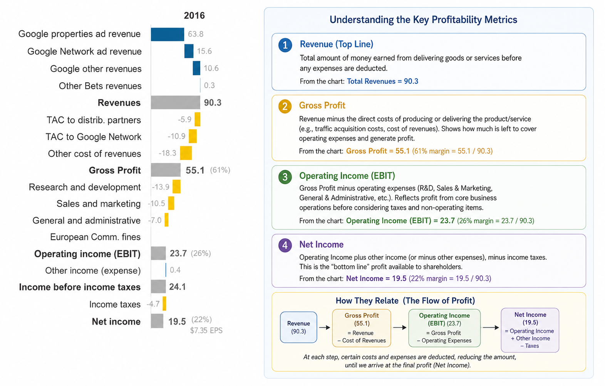
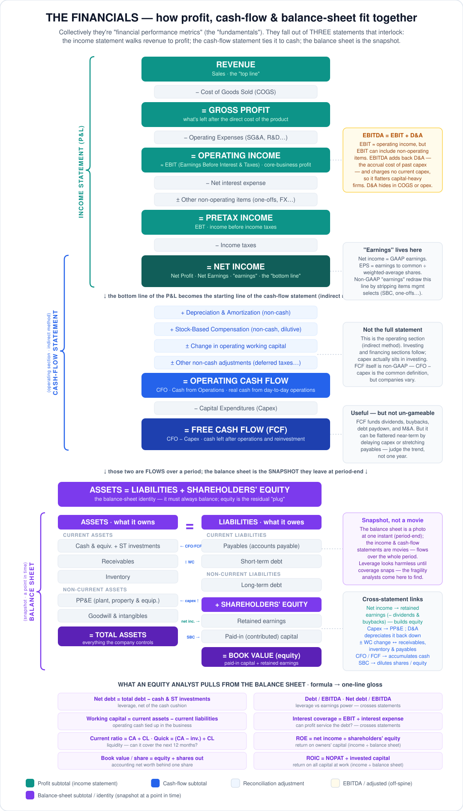

# Financial terms
- there is an umbralla term for earnings numbers - financial performance metrics (informally the fundamentals or the financials)
- Income Statement (the P&L) → the profit/earnings measures: Revenue → Gross Profit → Operating Income (EBIT) → Net Income. These are "profitability measures at different levels of the P&L."
- Cash-Flow Statement → the cash measures: Operating Cash Flow (CFO) → Free Cash Flow (FCF).

## waterfall cart

There is a standard framework for diagraming this — it's called the income statement waterfall plus the free-cash-flow bridge.

# GAAP earnings
- GAAP is the standard SEC earnings
- Non-GAAP earnings are the company's own adjusted version: they start with GAAP and strip out items management considers non-representative of core operations. Typical exclusions:
    - Stock-based compensation (the big one for tech)
    - Amortization of acquired intangibles
    - Restructuring/impairment charges
    - One-off legal settlements or tax items
- Non-GAAP is genuinely useful for seeing operational trajectory — whether the underlying engine is improving quarter to quarter.