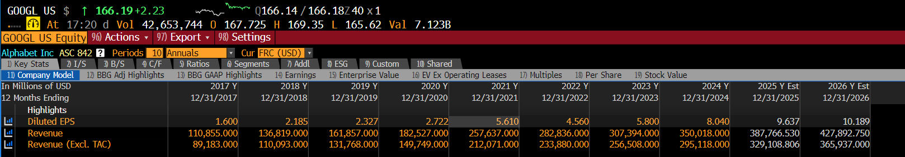

# Fundamental Analysis

- Higher price for larger growth rate
    - use <equity> FA GRO <GO> to check the growth rate in revenue
    - **tips from Burton →** buy only companies that are expected to have above-average earnings growth for five or more years.
- Higher price (WITH ALL OTHER THINGS EQUIAL) for larger portion of dividends and buy back.
    - **tips from Burton →** Never pay more for a stock than its foundation of value
    - The trick here is to buy unrecognized growth stocks who’s growth has not yet reflected in it’s P/E multiple. One way to do this is via PEG ratio (growth/(P/E))
    - **tips from Burton →** Look for stocks that has a story that the market and YOU feels good about. Buy stocks that could build a castle in the air.
- Higher price (WITH ALL OTHER THINGS EQUAL) for lower risk.
- The higher the interest rate, the lower the premium

# **A Case Study - GOOGL**

## Calculate EPG rate workflow:

1. Current price $166.19
2. Current P/E = $18,28 (just for reference)
3. Forward EPS Estimates
    1. 2024E EPS = $8.04
    2. 2025E EPS = $9.637
    3. 2026E EPS = $10.189
4. Calculate Forward Growth Rate
5. Calculate CAGR (optional)
6. Calculate PEG

## 🔢 1. **Basic Formula (1-Year Forward Growth)**

If you have EPS estimates for two years:

$$
{EPS Growth Rate} = \frac{\text{EPS}_{\text{future}} - \text{EPS}_{\text{current}}}{\text{EPS}_{\text{current}}} \times 100\%
$$

### ✅ Example (From Your Screenshot):

- **2025E EPS** = 9.637
- **2024E EPS** = 8.04

$$\text{EPS Growth Rate} = \frac{9.637 - 8.04}{8.04} = 0.1985 = \boxed{19.85\%}$$

---

## 📘 2. **CAGR (Compound Annual Growth Rate)** for Multi-Year Growth

If you're comparing EPS over **multiple years**, use:

$$text{CAGR} = \left( \frac{\text{EPS}_{\text{end}}}{\text{EPS}_{\text{start}}} \right)^{\frac{1}{n}} - 1$$

Where:

- `n` = number of years
- $$EPSstart_{\text{start}}start$$ and $$EPSend_{\text{end}}end$$ are the beginning and ending EPS values

### ✅ Example:

Using 2023 EPS = 5.80 and 2026E EPS = 10.159

(3 years: 2023 → 2026)

$$\text{CAGR} = \left( \frac{10.159}{5.80} \right)^{1/3} - 1 \approx 0.209 = \boxed{20.9\%}$$

### PEG using 1-year forward growth

$$
\text{PEG Ratio} = \frac{18.28}{19.85} = \boxed{0.921}
$$

### PEG using 2-year CAGR

$$
\text{PEG Ratio} = \frac{18.28}{20.9} = \boxed{0.875}
$$

**Given 1 to be properly valued, Google is moderately undervalued**

## Here is a table for all stocks in my protfolio

## 📊 Updated PEG Ratio Summary Table (Now includes PLTR)

| Ticker | Price | EPS (Curr→F1→F2) | Forward P/E | 1Y EPS Growth | **PEG (1Y)** | 2Y EPS CAGR | **PEG (2Y)** | ⚠️ Caveats |
| --- | --- | --- | --- | --- | --- | --- | --- | --- |
| **AAPL** | $211.26 | 6.13 → 6.08 → 7.19 | 34.75 | -0.82% | ❌ N/A | 13.44% | 2.59 | EPS drop next year |
| **GOOGL** | $166.19 | 5.79 → 8.04 → 9.64 | 20.67 | 38.69% | 0.53 | 21.65% | 0.96 | Solid value |
| **MSFT** | $454.27 | 9.81 → 11.80 → 15.17 | 38.51 | 20.27% | 1.90 | 13.44% | 2.87 | Fully valued |
| **TSLA** | $349.98 | 3.12 → 2.42 → 2.999 | 144.62 | -22.44% | ❌ N/A | 11.55% | 12.52 | EPS declining, extreme P/E |
| **META** | $640.34 | 14.87 → 23.86 → 28.22 | 26.83 | 60.42% | 0.44 | 8.73% | 3.07 | PEG spikes post rebound |
| **NVDA** | $135.40 | 0.334 → 1.296 → 2.99 | 104.45 | 130.7% | 0.80 | 84.0% | 1.24 | High growth priced in |
| **PLTR** | $22.93 | 0.25 → 0.30 → 0.47 | 76.43 | 20.0% | 3.82 | 25.04% | 3.05 | Expensive vs modest growth |