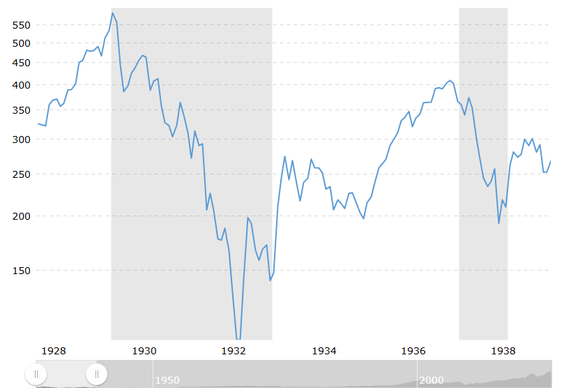
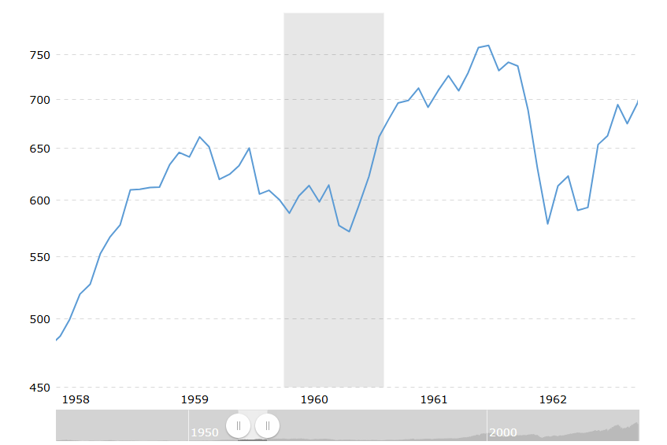
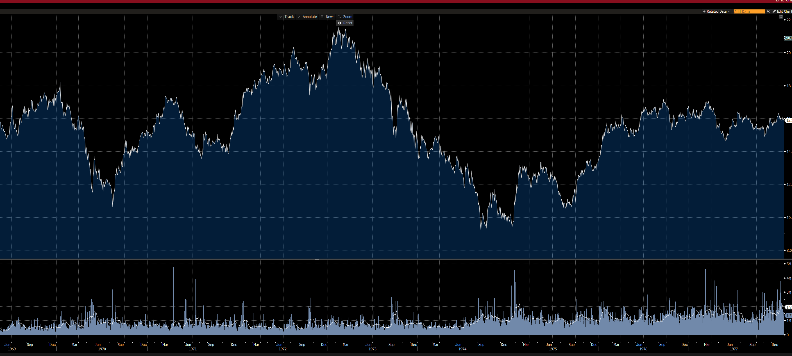
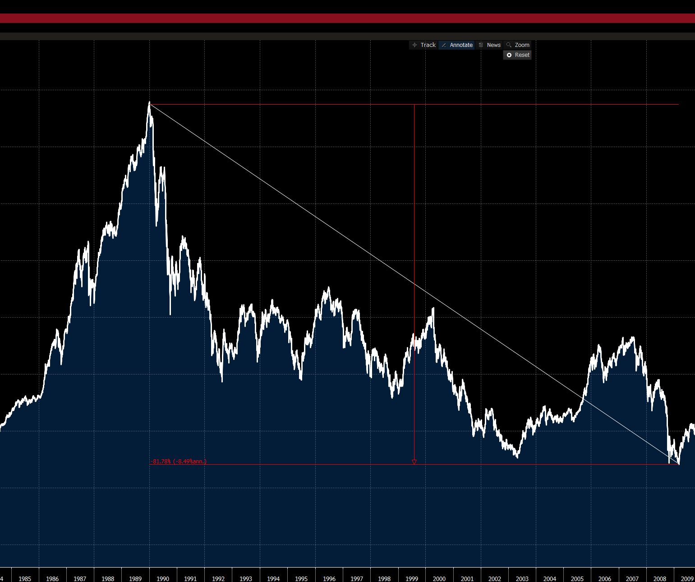
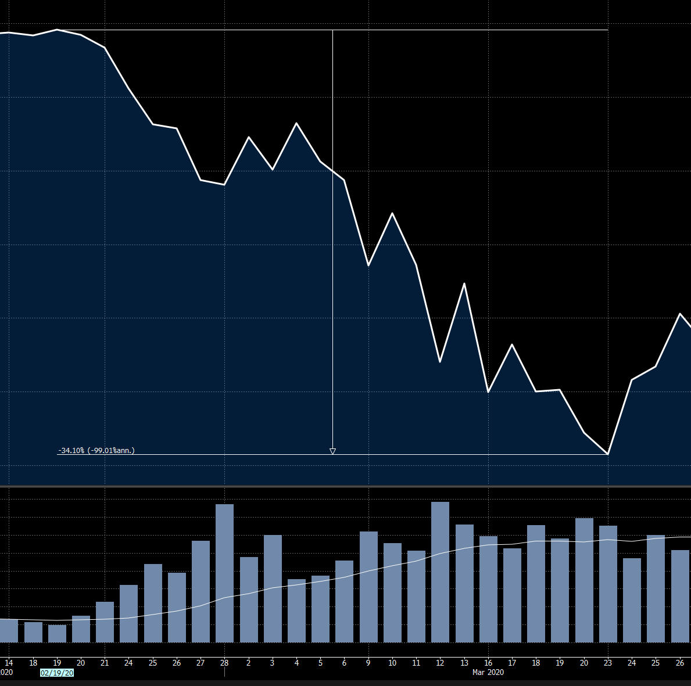

# Historical Breaks

# Historical Breaks

The break in 1929. The downfall started on September 3 and did not end until the July of next year. The stock market did not return to the 1929 level until 1955, almost 30 years latter.

The tronic boom break was much milder, the boom started from 1959 to 1962 and the crush took from march to June. The market did not recover until August next year.

It is almost as difficult to predict the downfall as it is to predict the upraising but the trend is your friend here. 

This shows both the conglomerate bubble and the Nifty Fifty bubble. All these chart showed real recession takes years in the making.

It took almost 10 years for the Nikkie to reach it’s bottom. 

It takes month if not years for most of the historical great breaks to reach maturaty. If it reaches the bottom in a week it is not a great break (hense not worth buying anyway. Be patient, dont become the. You have the most valuable thing in the world right now, hold it. 

Covid 19 took almost a month to lose 34%

