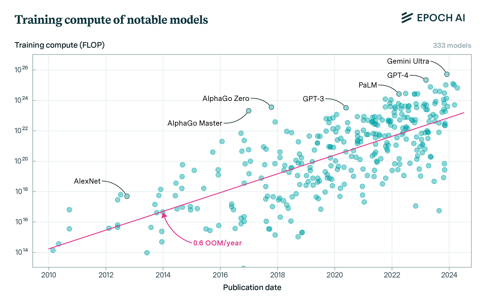

# Road to 1m

*Situational awareness*

We can decompose the progress in the four years from GPT-2 to GPT-4 into three categories of scaleups:

1. *Compute*: We’re using much bigger computers to train these models.
    1. Moore’s law is about 1-1.5 OOMs per decade.
    2. Currently increase in compute power is doing roughly 2 OOMs  per year. Crazy number but mostly due to capital expenditure.
        1. 
        
        
        
        the training compute is doing roughly 3x per year. 
        
        1. As an investor the question is then whether or not this spending curve is under the growth curve of the LLM’s capability. More specifically if the ability of the LLMs to produce profit. If so then such large spending can keep going.
        2. this tells me that we are in an insane spending cycle for AI infra. Most likely the first wave of winner in the cycle are hardware providers. I need to capture this wave from the right side of the business, i.e. the seller of the hardware not the buyer of the hardware. We need to also indicate a point where the buyers of the hardware will start to capture the majority of the profits. this is when the hyperscalers starting to see rapid revenue growth related to their AI cloud business.
            1. we need to identify players in the space where they have a relatively large moat in the 3 year time frame that can help us capture this 0.6 OOMs spending. This predicted growth should also not be priced in already. 
            2. **You need to be extremely careful during this process. Semiconductor is a highly specialized sector with violent changes currently. You are still early in the AI business cycle. You only have to be right once so you should be extremely cautious when placing bets**
            
            [Picks and Shovels Candidate](road-to-1m/picks-and-shovels-candidate.md)
            
        3. the risk associated with this is
            1. as mentioned above, the LLM profitablity curve is lagging behind the spending curve. this seems to be difficult to estimate, i will need to spend some time in this
            2. I foresee a stagnation phase at the end of this cycle where the general models are good enough just like 100M board band internet is enough for average users. This might be different in the AI case where there is a winner takes all end game that a vastly smarter AI will dominate less models in every layer of the market. This needs further investigation.
2. *Algorithmic efficiencies*: There’s a continuous trend of algorithmic progress. Many of these act as “compute multipliers,” and we can put them on a unified scale of growing *effective compute*.
    1. Inference efficiency improved by nearly 3 OOMs—1,000x—in less than two years.
    2. I want to be sure that the increase in inference efficiency won’t be a thread to massive investment in the computing infrustructure
    3. ImageNet which is a long-term public data source shows that long-term compute efficiency growth could be close to ~0.5 OOMs/yr
    4. GPT-2 to GPT-4 jump included 1-2 OOMs of algorithmic efficiency gains.
    5. roughly GPT-2 to GPT-4 is a 5 OOMs growth. Algorithm and Compute investment account for roughly the same.
    6. 
3. *”Unhobbling” gains*: By default, models learn a lot of amazing raw capabilities, but they are hobbled in all sorts of dumb ways, limiting their practical value. With simple algorithmic improvements like reinforcement learning from human feedback (RLHF), chain-of-thought (CoT), tools, and scaffolding, we can unlock significant latent capabilities.

## Resources

- Leaderboards
    - coding
        - [https://www.swebench.com/](https://www.swebench.com/)
    - tooling usage
        - [https://gorilla.cs.berkeley.edu/leaderboard.html](https://gorilla.cs.berkeley.edu/leaderboard.html)
    - general capabilities
        - [https://crfm.stanford.edu/helm/capabilities/latest/#/leaderboard](https://crfm.stanford.edu/helm/capabilities/latest/#/leaderboard)
- [https://epoch.ai/](https://epoch.ai/)

*Some candidates*

[Light](road-to-1m/light.md)