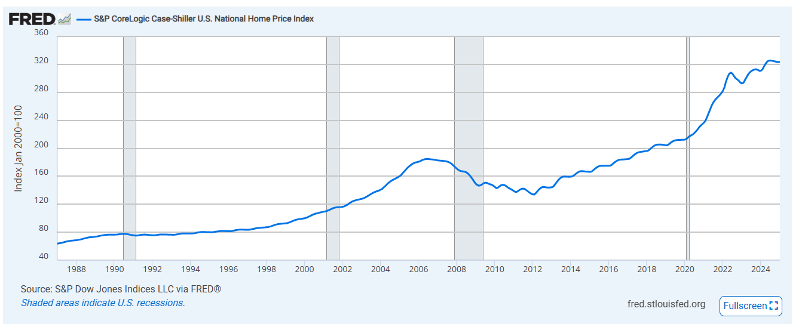
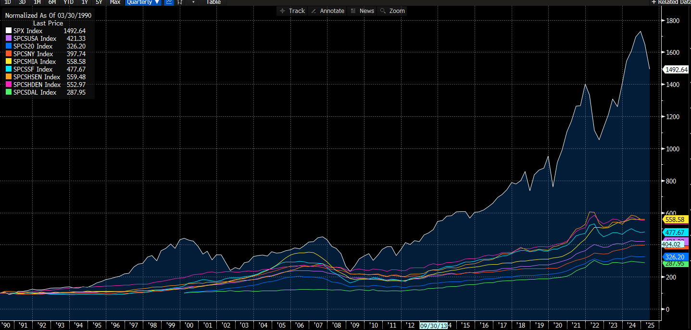
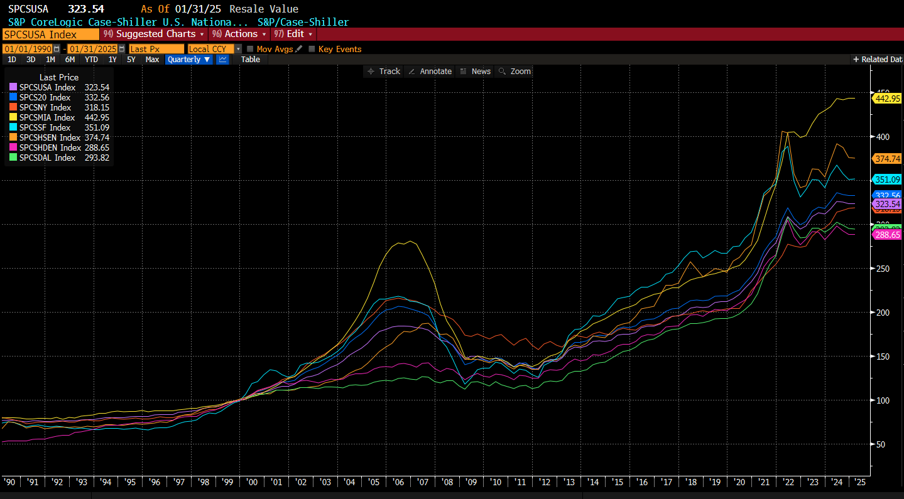
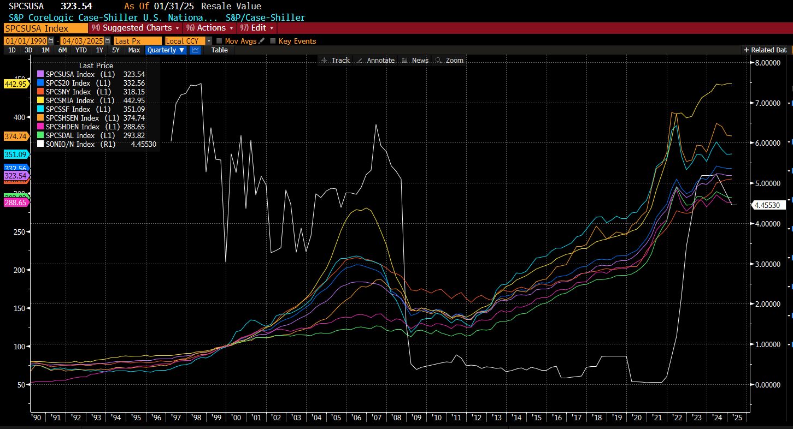

# Housing

**S&P CoreLogic Case-Shiller U.S. National Home Price Index**

you should check the whether or not your data is inflation adjusted. The pure SPCSUSA is not price adjusted. (Here is a CPI adjusted version: [https://fred.stlouisfed.org/graph/?g=kYEb](https://fred.stlouisfed.org/graph/?g=kYEb))

Here is the link to the methology: [https://www.spglobal.com/spdji/en/documents/methodologies/methodology-sp-corelogic-cs-home-price-indices.pdf](https://www.spglobal.com/spdji/en/documents/methodologies/methodology-sp-corelogic-cs-home-price-indices.pdf)

Each of these indices is constructed using the repeat sales methodology, which measures the price change between two arms-length sales of the same property, ensuring that only real price appreciation or depreciation is captured while holding the quality of the property constant.

SA → seasonally adjusted

NSA → Non-seasonally adjusted

YOY and MOM track the changes in SPCS indexes

This s a graph of various SPCS indices against SNP, This is not a perfect graph, as the proportion of the indexises are different, however this is to show that SPX is a more volatile yet profitable investment against housing. 

This is a graph shows SPCS of various metropolitine area. now this view starting to show that housing is a valid investment if you can enter the market at the right time with the right morgage rate. 

Here is the same graph with the US interest rate

