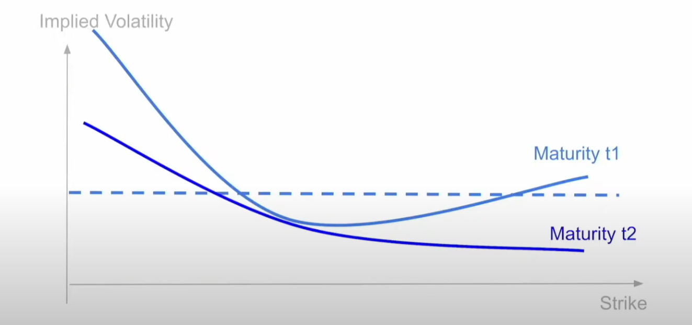

# Options

# Lingos

- out-of-the-money → current option has no intrinsic value, strike price lower than current price
- in-the-money → current option has intrinsic value,
- at-the-money → current asset has the same price as the strike price
- option value based on
    - Strike price
    - time until expiration
    - implied volatility (benchmark volatility)
        - same level of volatility exists for all options of the same asset with the same expiry

**Figure1 shows the volatility smile indctates that the volitility of the option increase for both in-the-money(right arrow) and out-of-the-money(left arrow) options. horrizontal dash line indicates the volitility level predicted by the Black-Scholes model.**

Figure 2 shows the different volitility smile of same underlineing asset but different maturity (t1 earlier than t2). 

![Figure 3: Normally in Equity market, the volitility smile is skewed (into volitility smerk). this imply that the market worries more about a abnormal downturn of the equity market. (the spot price which is the lowest level of the curve is likely to move down). In comodidy market, such pressure is reversed so that the smile is smerk to the right ( the market wants protection from the increase in commodity price. Interestingly, such skewing is not observed in the bitcoin market meaning that the invester does not know which side to worry about. ](options/image-2.png)

Figure 3: Normally in Equity market, the volitility smile is skewed (into volitility smerk). this imply that the market worries more about a abnormal downturn of the equity market. (the spot price which is the lowest level of the curve is likely to move down). In comodidy market, such pressure is reversed so that the smile is smerk to the right ( the market wants protection from the increase in commodity price. Interestingly, such skewing is not observed in the bitcoin market meaning that the invester does not know which side to worry about.