# intro to cpo
CPO, a technology that deeply co-packages the optical engine with the switch chip
The evolution of CPO was not a sudden success; it evolved gradually from NPO (Near-Package Optics)
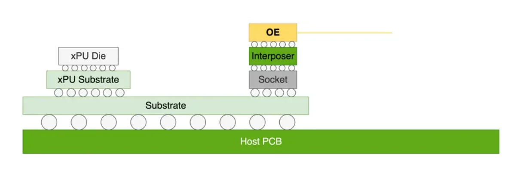

The core concept of CPO is to tightly integrate the optical engine (OE) and switch ASIC chip within the same package through advanced packaging processes, shortening the transmission distance of electrical signals from centimeters to millimeters
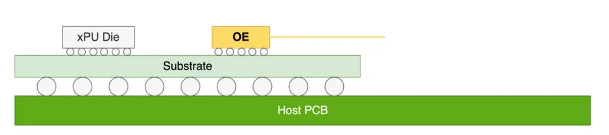

Type A CPO (2.5D packaging): The distance between the ASIC and the optical engine is further shortened to less than 10 cm.
Type B CPO (2.5D chiplet packaging): The introduction of wafer-level packaging technology improves interconnection efficiency.
Type C CPO (3D packaging): The final form, achieving vertical integration of optoelectronic chips and the shortest interconnect paths.

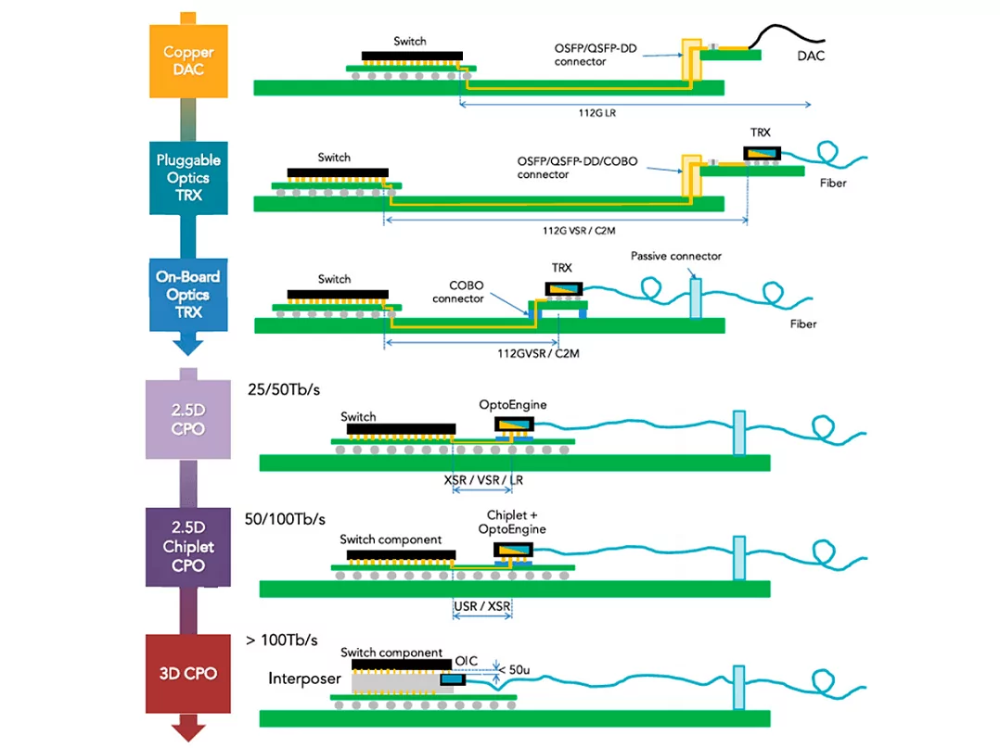

CPO's core innovation lies in integrating optical components directly into the switch ASIC package using silicon interposers or micro-bump interconnect technology, fundamentally shortening the signal transmission path to millimeters

the high integration and miniaturization of components will significantly reduce the cost per module with technology maturity and mass production. Simultaneously, CPO has a clear advantage in operating costs (OPEX), mainly reflected in improved power consumption, latency, and conversion efficiency (by ~50%)

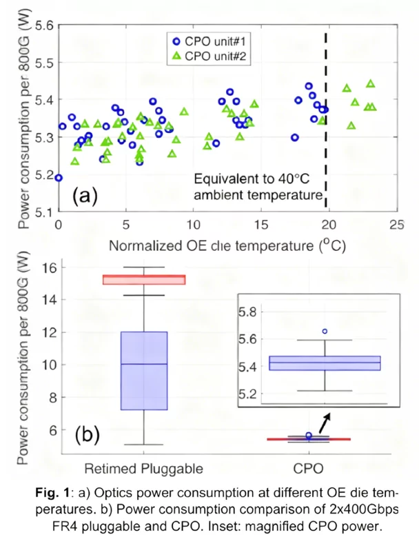

# difference and relationship between cpo and silicon photonic

# GS report summary

- Networking is the next frontier in AI infrastructure
- Scale out = connecting more racks/clusters together.
- Scale up = making multiple GPUs behave more like one big machine.
- all connection types grow, not one winner replacing all others. copper, PCB midplanes, pluggable optical modules, and CPO/NPO  optical engines all to grow because they serve different distance, cost, bandwidth, and power needs.

## From NVL72 to NVL576

- a major scale-up expansion
  - Per computing unit
    - NVL576 is treated as one computing unit made of 8 NVL72-style racks.
    - aggregate dollar content per computing unit across scale up and scale out to increase by 29x from US$315k to US$9.4mn

  - Total market
    - A 13x TAM for optical modules / optical engines expanding
    - A 10x TAM for pluggable optical modules
    - assume number of racks 48k for GB300 NVL72 to 16.5k NVL576, TAM increase 9x from $15bn to $154bn 
    - 69% goes to scale up, or $106bn
    - 31% goes to scale out, or $48bn
    - **CPO contributes US$91bn, or 59% of the US$154bn value TAM, assuming CPO at 29% penetration rate in scale out**

## From TAM to valuation
- Company CPO revenue = CPO TAM × component segment share × company market share
- CPO net income = CPO revenue × net margin
- Incremental market cap = CPO net income × P/E multiple

## Scale up / Scale out TAM opportunities
### full analysis
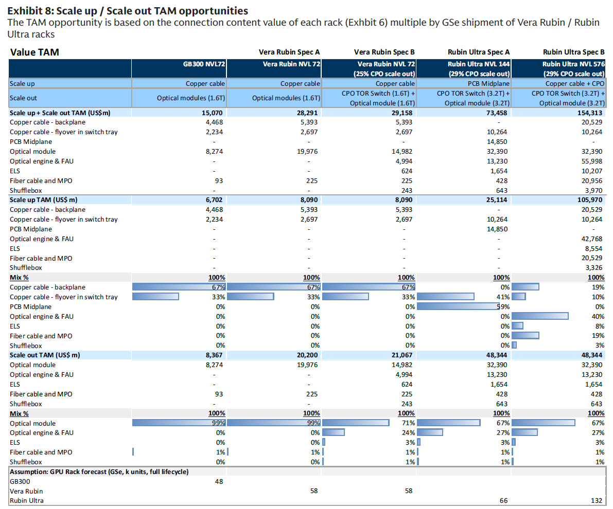
### summary
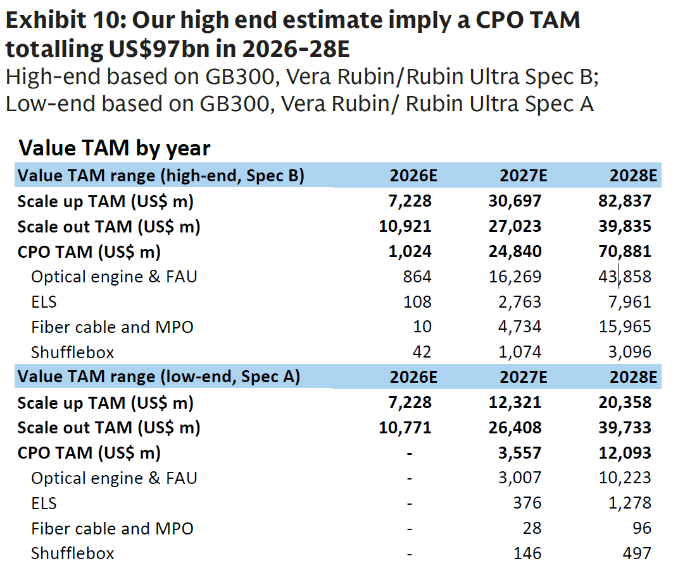

## SiPh chip structure
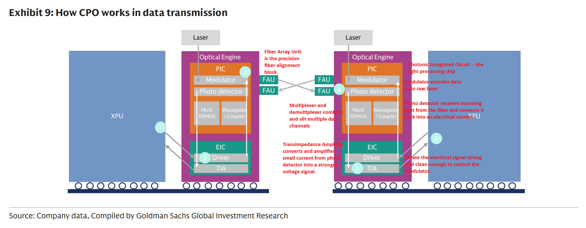
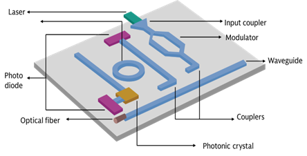

## optics speed upgrade trend
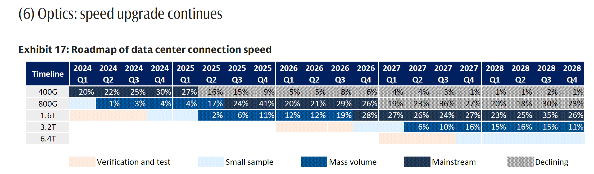

## Silicon photonics
- because of the speed migration from, 800G to 1.6T, we expect EML based pluggable optical modle (transivers) to shift EML -> SiPh transivers -> CPO switches -> CPO XPUs
- enbeded photonic device on silicon chips
- Silicon Photonics dictates how the data is transmitted (using light on a silicon wafer), while CPO dictates where the optical components are located relative to the processor
- Pros:
  - a higher level of integration and
  - smaller size
  - lower power consumption
  - lower costs
- Cons:
  - CW lasers require high power to deliver similar performance to EML
  - long-established technology with a longer track record, and the reliability

## Light source

CPO will have an external light source for field servisibility
Supply tightness remains in 2026, across both EML and CW lasers, due to (1) strong
demand driven by AI servers ramp up, speed migration, and optical connections
expansion, (2) InP substrate supply constraints, which are used in both EML and CW
lasers, and across PD (receivers) and LD (transmitters), and under geopolitical tension /
export controls by the China government, and (3) it takes time for capacity expansion
and ramp up across the supply chain
- major players
  - VPEC InP, LandMark, YJ Semi, Lumentum, Coherent, 
- supply remain tight through 2027 till 2h 2028

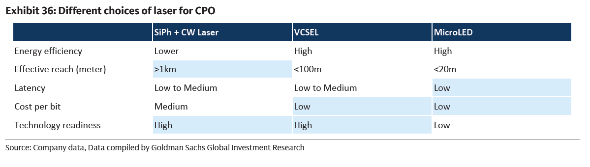

## Pluggable optical modules
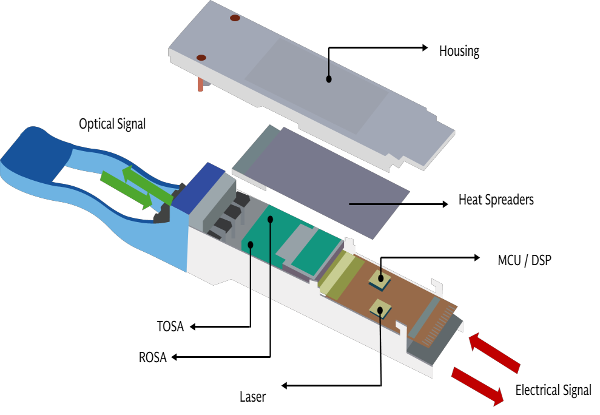
- DSP process messy light and electric signals, think of it as the brain of the module
  - DSP is mostly controlled by MRVL (~40%) and AVGO (~35%)
  - 
- TOSA translate electric singal to light signal
  - evolution: DML -> CW -> EML -> SiPh
  - EML is 800G to 1.6T major player
- ROSA translate light signal to electric signal
- INTC used to have a optical module/CPO business, this was sold to Jabil.
- Corning and Taichenguang
- value is flowing into CPO/SiPh Light source, NVDA AVGO, and TFLN

1. The headline TAM jump is from $15bn to $154bn.
Goldman estimates total scale-up + scale-out networking TAM rises from about $15bn for GB300 NVL72 to $154bn for Rubin Ultra NVL576. Of that $154bn, they estimate $106bn, or 69%, goes to scale-up, and CPO contributes $91bn, or 59% of the total, assuming 29% CPO penetration in scale-out.

That is the real “aha” of the report: scale-up networking becomes a huge market, not just traditional data-center scale-out Ethernet/InfiniBand.

2. CPO is important, but not magic.
CPO means co-packaged optics: putting optical engines very close to the switch ASIC or XPU/GPU to shorten the electrical path. The report says this can reduce power, latency, and the need for DSPs/retimers. But the downside is serviceability. With pluggable modules, you can replace a failed module. With NPO/CPO, failures can affect the switch PCB, switch ASIC, or even XPU package. So Goldman expects pluggables and CPO/NPO to co-exist, not for CPO to immediately replace pluggables.

3. Silicon photonics is another major theme.
For pluggable optical modules, the report expects silicon photonics penetration in datacom to rise sharply, from 6% in 1Q24 to roughly 45%–46% by 4Q28E. The reason: higher integration, smaller size, lower power consumption, and lower cost, especially as speeds migrate to 800G, 1.6T, and 3.2T. But EML-based modules still coexist, especially where reliability track record and long-distance performance matter.